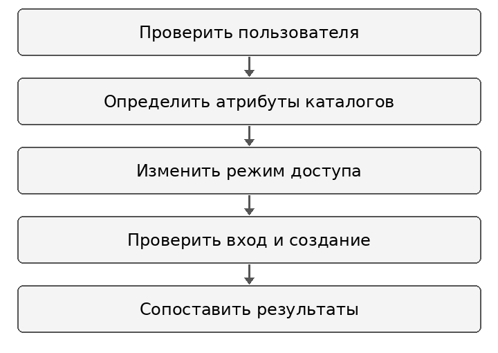
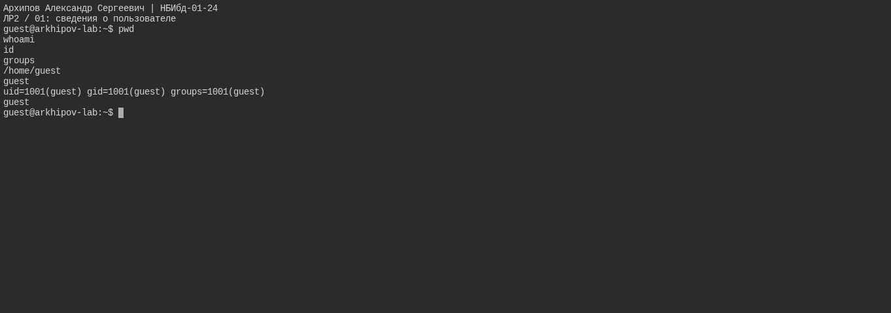
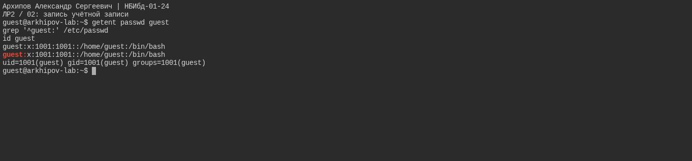
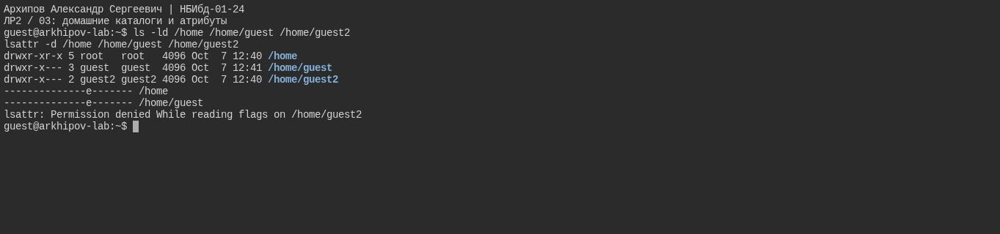
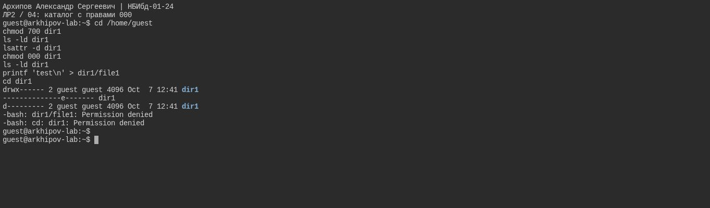
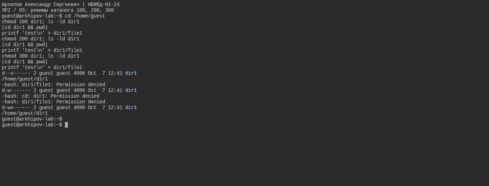

---
author:
  name: Архипов Александр Сергеевич
  email: 1132239106@rudn.ru
  affiliation:
  - name: Российский университет дружбы народов
    city: Москва
    country: Российская Федерация
title: Отчёт по лабораторной работе 2
subtitle: Дискреционное разграничение прав в Linux Основные атрибуты
abstract: Исследованы права владельца на файлы и каталоги Linux. Проверены режимы каталога 000, 100, 200 и 300; результаты сопоставлены с правилами дискреционного доступа. Полная матрица сочетаний прав приведена как теоретический расчёт.
keywords:
- информационная безопасность
- лабораторная работа
- Linux
date: '2026-10-12'
date-format: DD.MM.YYYY
lang: ru-RU
---

# Введение

Исполнитель — Архипов Александр Сергеевич, группа НБИбд-01-24. Студенческий билет 1132239106. Электронная почта: 1132239106@rudn.ru.

## Актуальность

Права файлов определяют, какие действия пользователь может выполнить с данными. Для настройки доступа необходимо различать права самого файла и права каталога, в котором он находится.

## Цель работы

Получить практические навыки работы в консоли с атрибутами файлов, закрепить теоретические основы дискреционного разграничения доступа в современных системах с открытым кодом на базе ОС Linux.

## Задачи

1. Определить идентификаторы и рабочий каталог пользователя guest.
2. Проверить атрибуты домашних каталогов и доступ к чужому каталогу.
3. Сравнить создание файла и вход в каталог при режимах 000, 100, 200 и 300.
4. Сопоставить наблюдения с теоретической матрицей прав и определить минимальные разрешения.

## Объект и предмет исследования

Объект исследования — файлы и каталоги учебной Linux-системы. Предмет исследования — зависимость доступных владельцу операций от битов r, w и x.

## Методы исследования

Использованы консольный эксперимент, изменение режимов доступа командой chmod и сравнение успешных операций с сообщениями Permission denied. Полная матрица рассчитана по правилам доступа отдельно от выполненных проверок.

## Схема выполнения работы

Последовательность действий показана на @fig-workflow.

{#fig-workflow width=65%}

# Теоретическая часть

В дискреционной модели права задаются для владельца, группы и остальных пользователей. Значения r, w и x представляются восьмеричными весами 4, 2 и 1; их сумма образует цифру режима [@gnu-modes].

Для обычного файла r разрешает чтение, w — изменение содержимого, x — исполнение. Для каталога r разрешает просмотр имён, x — поиск и обращение к объектам внутри каталога. Создание, удаление и переименование требуют сочетания w и x на каталоге. Удаление записи каталога не определяется правом записи в сам файл [@gnu-permissions].

Владелец может менять обычные права своего файла, если путь к нему доступен. Поэтому отсутствие r и w на файле не означает запрет chmod. Расчётная матрица в приложении предполагает отсутствие дополнительных ограничений ACL, специальных атрибутов и Sticky-бита.

# Материалы и методы

Учебная среда — Ubuntu 24.04 на Killercoda. Пользователь guest имеет UID 1001 и GID 1001. Учётную запись создал администратор; парольный вход заблокирован, переключение пользователя выполнено через su. Использованы id, pwd, ls, lsattr, chmod, touch и cd. Проверены четыре режима каталога; пять снимков фиксируют учётные данные, атрибуты и результаты операций.

# Выполнение лабораторной работы

## Сведения о пользователе

Сеанс принадлежит guest, рабочий каталог /home/guest. UID/GID этой ВМ: 1001/1001.

Результат показан на @fig-real-001.

{#fig-real-001 width=90%}

## Запись учётной записи

UID/GID в /etc/passwd совпадают с id. Это фактическая запись новой учебной ВМ.

Результат показан на @fig-real-002.

{#fig-real-002 width=90%}

## Домашние каталоги и атрибуты

Атрибуты /home и своего дома доступны. Для чужого /home/guest2 с режимом 750 lsattr от guest получает отказ: это ожидаемый контроль доступа.

Результат показан на @fig-real-003.

{#fig-real-003 width=90%}

## Каталог с правами 000

При 000 владелец не может создать файл и войти в каталог. Оба Permission denied ожидаемы.

Результат показан на @fig-real-004.

{#fig-real-004 width=90%}

## Режимы каталога 100 200 300

100: вход разрешён, создание запрещено; 200: оба действия запрещены; 300: оба разрешены. Снимок проверяет эти три режима, а не полную матрицу 64 пар прав.

Результат показан на @fig-real-005.

{#fig-real-005 width=90%}

# Результаты

| Режим каталога | Вход в каталог | Создание файла |
|:---:|:---:|:---:|
| 000 | Запрещён | Запрещено |
| 100 | Разрешён | Запрещено |
| 200 | Запрещён | Запрещено |
| 300 | Разрешён | Разрешено |

: Результаты консольных проверок {#tbl-results}

Команда id показала UID/GID 1001/1001. Запись /etc/passwd соответствует этим идентификаторам. Попытка получить атрибуты чужого домашнего каталога с режимом 750 завершилась отказом доступа. Теоретическая матрица содержит 64 сочетания; выполненные проверки не подтверждают экспериментально все её строки.

# Обсуждение результатов

Результаты показывают, что одного права записи в каталог недостаточно для создания файла: необходим также бит x. Режим 100 позволяет войти в каталог, но не изменять набор его записей. Совместное наличие w и x в режиме 300 разрешает создание файла.

Эти наблюдения согласуются с расчётными правилами. Таблицы приложения описывают более широкий набор сочетаний, чем проведённый эксперимент; при их применении следует учитывать дополнительные механизмы защиты конкретной системы.

# Заключение

- Определены фактические идентификаторы guest и атрибуты домашних каталогов.
- Подтверждена роль бита x и сочетания w+x для операций с каталогом.
- Составлены расчётная матрица и таблица минимальных прав; область экспериментальной проверки ограничена режимами 000, 100, 200 и 300.

# Список литературы {.unnumbered}

::: {#refs}
:::

\appendix

# Расчётная матрица прав {.appendix}

Обозначения: 1 — создание файла; 2 — удаление; 3 — запись; 4 — чтение; 5 — вход в каталог; 6 — просмотр имён; 7 — переименование; 8 — изменение обычных прав. Знак плюс означает разрешение, минус — запрет.

Расчётная матрица (@tbl-matrix) является теоретической. Учтены обычные биты доступа; дополнительные ограничения ACL, SELinux, a/i и Sticky в расчёт не включены. Биты относятся к владельцу.

| Каталог | Файл | 1 | 2 | 3 | 4 | 5 | 6 | 7 | 8 |
|:---:|:---:|:---:|:---:|:---:|:---:|:---:|:---:|:---:|:---:|
| 000 | 000 | - | - | - | - | - | - | - | - |
| 100 | 000 | - | - | - | - | + | - | - | + |
| 200 | 000 | - | - | - | - | - | - | - | - |
| 300 | 000 | + | + | - | - | + | - | + | + |
| 400 | 000 | - | - | - | - | - | + | - | - |
| 500 | 000 | - | - | - | - | + | + | - | + |
| 600 | 000 | - | - | - | - | - | + | - | - |
| 700 | 000 | + | + | - | - | + | + | + | + |
| 000 | 100 | - | - | - | - | - | - | - | - |
| 100 | 100 | - | - | - | - | + | - | - | + |
| 200 | 100 | - | - | - | - | - | - | - | - |
| 300 | 100 | + | + | - | - | + | - | + | + |
| 400 | 100 | - | - | - | - | - | + | - | - |
| 500 | 100 | - | - | - | - | + | + | - | + |
| 600 | 100 | - | - | - | - | - | + | - | - |
| 700 | 100 | + | + | - | - | + | + | + | + |
| 000 | 200 | - | - | - | - | - | - | - | - |
| 100 | 200 | - | - | + | - | + | - | - | + |
| 200 | 200 | - | - | - | - | - | - | - | - |
| 300 | 200 | + | + | + | - | + | - | + | + |
| 400 | 200 | - | - | - | - | - | + | - | - |
| 500 | 200 | - | - | + | - | + | + | - | + |
| 600 | 200 | - | - | - | - | - | + | - | - |
| 700 | 200 | + | + | + | - | + | + | + | + |
| 000 | 300 | - | - | - | - | - | - | - | - |
| 100 | 300 | - | - | + | - | + | - | - | + |
| 200 | 300 | - | - | - | - | - | - | - | - |
| 300 | 300 | + | + | + | - | + | - | + | + |
| 400 | 300 | - | - | - | - | - | + | - | - |
| 500 | 300 | - | - | + | - | + | + | - | + |
| 600 | 300 | - | - | - | - | - | + | - | - |
| 700 | 300 | + | + | + | - | + | + | + | + |
| 000 | 400 | - | - | - | - | - | - | - | - |
| 100 | 400 | - | - | - | + | + | - | - | + |
| 200 | 400 | - | - | - | - | - | - | - | - |
| 300 | 400 | + | + | - | + | + | - | + | + |
| 400 | 400 | - | - | - | - | - | + | - | - |
| 500 | 400 | - | - | - | + | + | + | - | + |
| 600 | 400 | - | - | - | - | - | + | - | - |
| 700 | 400 | + | + | - | + | + | + | + | + |
| 000 | 500 | - | - | - | - | - | - | - | - |
| 100 | 500 | - | - | - | + | + | - | - | + |
| 200 | 500 | - | - | - | - | - | - | - | - |
| 300 | 500 | + | + | - | + | + | - | + | + |
| 400 | 500 | - | - | - | - | - | + | - | - |
| 500 | 500 | - | - | - | + | + | + | - | + |
| 600 | 500 | - | - | - | - | - | + | - | - |
| 700 | 500 | + | + | - | + | + | + | + | + |
| 000 | 600 | - | - | - | - | - | - | - | - |
| 100 | 600 | - | - | + | + | + | - | - | + |
| 200 | 600 | - | - | - | - | - | - | - | - |
| 300 | 600 | + | + | + | + | + | - | + | + |
| 400 | 600 | - | - | - | - | - | + | - | - |
| 500 | 600 | - | - | + | + | + | + | - | + |
| 600 | 600 | - | - | - | - | - | + | - | - |
| 700 | 600 | + | + | + | + | + | + | + | + |
| 000 | 700 | - | - | - | - | - | - | - | - |
| 100 | 700 | - | - | + | + | + | - | - | + |
| 200 | 700 | - | - | - | - | - | - | - | - |
| 300 | 700 | + | + | + | + | + | - | + | + |
| 400 | 700 | - | - | - | - | - | + | - | - |
| 500 | 700 | - | - | + | + | + | + | - | + |
| 600 | 700 | - | - | - | - | - | + | - | - |
| 700 | 700 | + | + | + | + | + | + | + | + |

: Расчётная матрица сочетаний прав {#tbl-matrix}

# Минимальные права {.appendix}

Минимальные комбинации приведены в @tbl-minimum. Для удаления подкаталога дополнительно требуется, чтобы он был пустым.

| Операция | Каталог | Файл |
|:---|:---:|:---:|
| Создание файла | 300 | 000 |
| Удаление файла | 300 | 000 |
| Чтение файла | 100 | 400 |
| Запись в файл | 100 | 200 |
| Переименование файла | 300 | 000 |
| Создание поддиректории | 300 | 000 |
| Удаление поддиректории | 300 | 000 |

: Минимальные обычные права {#tbl-minimum}
