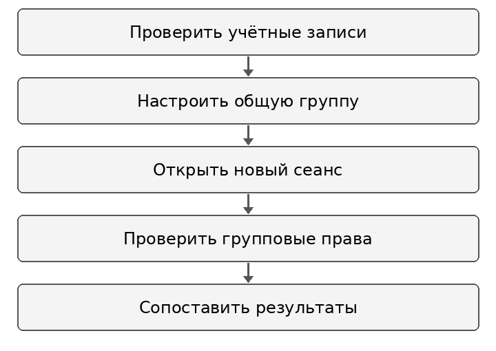
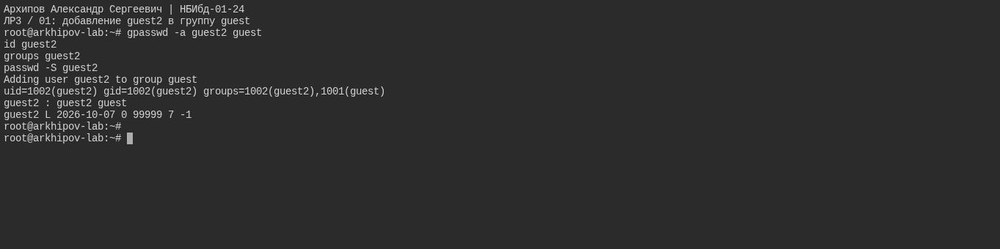
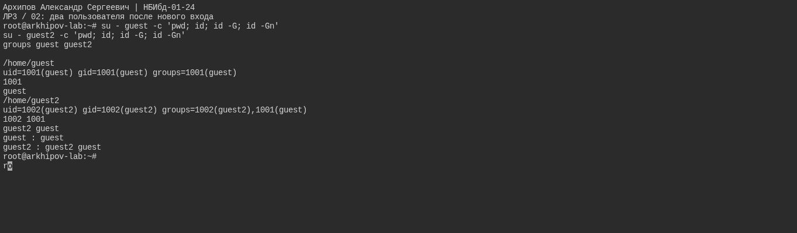
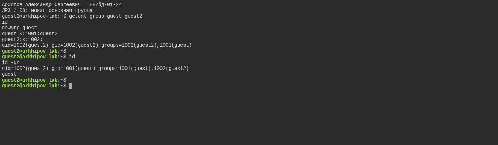
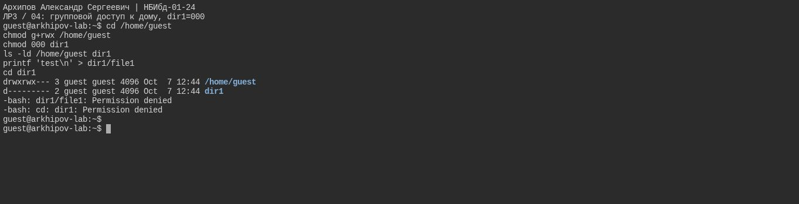
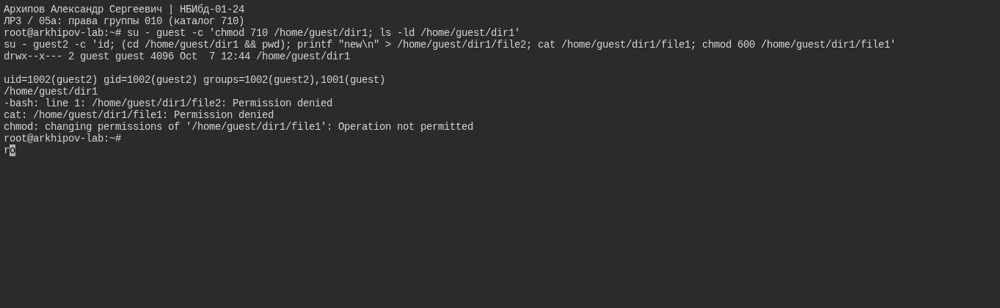
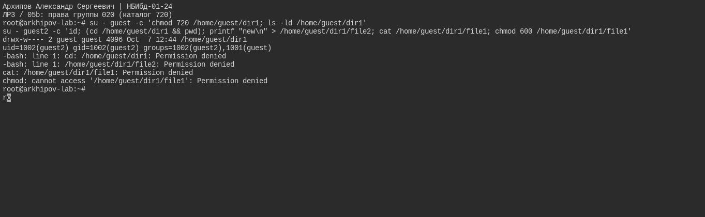
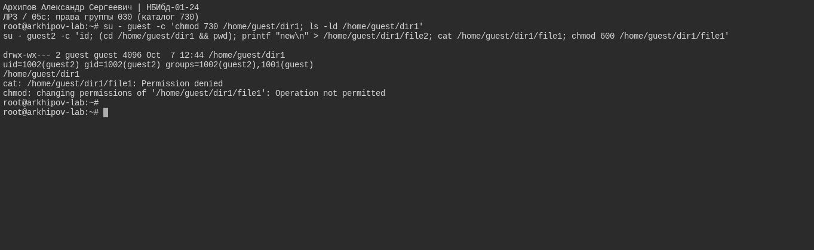

---
author:
  name: Архипов Александр Сергеевич
  email: 1132239106@rudn.ru
  affiliation:
  - name: Российский университет дружбы народов
    city: Москва
    country: Российская Федерация
title: Отчёт по лабораторной работе 3
subtitle: Дискреционное разграничение прав в Linux Два пользователя
abstract: Исследован доступ пользователя guest2 к объектам пользователя guest при общей группе. Проверены членство в группах, смена основной группы и режимы каталога 000, 710, 720 и 730. Расчётные групповые права отделены от результатов консольных проверок.
keywords:
- информационная безопасность
- лабораторная работа
- Linux
date: '2026-10-12'
date-format: DD.MM.YYYY
lang: ru-RU
---

# Введение

Исполнитель — Архипов Александр Сергеевич, группа НБИбд-01-24. Студенческий билет 1132239106. Электронная почта: 1132239106@rudn.ru.

## Актуальность

Общая группа позволяет предоставлять доступ нескольким пользователям без передачи владения файлами. Корректная настройка требует учитывать членство в группе, права каталогов и ограничения на изменение чужих файлов.

## Цель работы

Получение практических навыков работы в консоли с атрибутами файлов для групп пользователей.

## Задачи

1. Добавить guest2 в дополнительную группу guest и проверить новый сеанс.
2. Сменить основную группу с помощью newgrp.
3. Проверить групповые операции при режимах каталога 000, 710, 720 и 730.
4. Проверить возможность чтения file1 с режимом 000 и изменения его прав от guest2.

## Объект и предмет исследования

Объект исследования — учётные записи guest и guest2 и файлы в домашнем каталоге guest. Предмет исследования — групповые права и их отличие от прав владельца.

## Методы исследования

Использованы изменение состава групп, повторный вход, newgrp и консольные проверки доступа от guest2. Наблюдения сопоставлены с расчётной таблицей групповых разрешений.

## Схема выполнения работы

Последовательность действий показана на @fig-workflow.

{#fig-workflow width=65%}

# Теоретическая часть

Проверка прав учитывает владельца файла, его группу и группы процесса. Групповые биты применяются к участнику группы файла, если он не является владельцем; разрешения владельца и группы не суммируются [@gnu-modes].

Реальный и эффективный GID, а также дополнительные группы входят в набор идентификаторов процесса. Команда newgrp создаёт оболочку с выбранной основной группой; результат необходимо проверить в новом сеансе [@linux-credentials].

Для операций с каталогом группе также требуется x для обращения к объектам и w+x для создания и удаления. Членство в группе не даёт право менять обычные разрешения чужого файла: chmod разрешён владельцу или процессу с соответствующими привилегиями [@gnu-chmod].

# Материалы и методы

Учебная среда — Ubuntu 24.04. UID/GID guest равны 1001/1001, UID/GID guest2 — 1002/1002. У guest2 есть дополнительная группа guest. Парольный вход заблокирован; сеансы созданы администратором через su. Использованы id, groups, newgrp, chmod, touch, cat и cd. На семи снимках представлены членство в группах и проверки режимов 000, 710, 720 и 730.

# Выполнение лабораторной работы

## Добавление guest2 в группу guest

guest2 входит в guest. Статус L означает заблокированный парольный вход: пароли для этих временных аккаунтов не задавались. Вход выполнялся администратором через su.

Результат показан на @fig-real-001.

{#fig-real-001 width=90%}

## Два пользователя после нового входа

У guest2 после нового входа есть основная группа guest2 и дополнительная guest. Дома пользователей различаются.

Результат показан на @fig-real-002.

{#fig-real-002 width=90%}

## Новая основная группа

После newgrp guest основная группа действительно стала guest: gid=1001 и id -gn выводит guest.

Результат показан на @fig-real-003.

{#fig-real-003 width=90%}

## Групповой доступ к дому dir1 000

Владелец guest предоставляет группе доступ к дому, но права dir1=000 продолжают запрещать создание и вход.

Результат показан на @fig-real-004.

{#fig-real-004 width=90%}

## Права группы 010 (каталог 710)

guest2 может войти, но не создать file2. Чтение file1 с 000 и смена прав чужого файла запрещены.

Результат показан на @fig-real-005.

{#fig-real-005 width=90%}

## Права группы 020 (каталог 720)

Без группового x запрещены вход и доступ к файлам, несмотря на наличие группового w.

Результат показан на @fig-real-006.

{#fig-real-006 width=90%}

## Права группы 030 (каталог 730)

Групповые w+x разрешают вход и создание file2. Они не разрешают читать file1 с 000 или менять права чужого файла.

Результат показан на @fig-real-007.

{#fig-real-007 width=90%}

# Результаты

| Режим каталога | Групповые биты | Вход guest2 | Создание file2 |
|:---:|:---:|:---:|:---:|
| 000 | --- | Запрещён | Запрещено |
| 710 | --x | Разрешён | Запрещено |
| 720 | -w- | Запрещён | Запрещено |
| 730 | -wx | Разрешён | Разрешено |

: Результаты группового доступа {#tbl-results}

После нового входа guest2 состоит в дополнительной группе guest. После newgrp guest основная группа имеет GID 1001. Чтение file1 с режимом 000 и изменение его прав от guest2 запрещены. Матрица из 64 сочетаний в приложении является расчётной.

# Обсуждение результатов

Режимы 710, 720 и 730 различаются только групповыми разрешениями. Их сравнение подтверждает, что бит x отвечает за доступ к каталогу, а сочетание w+x позволяет создавать записи.

Запрет chmod сохраняется даже при доступном каталоге: пользователь guest2 не становится владельцем file1 за счёт членства в группе guest. Для совместной работы необходимо отдельно задавать права каталога и права файлов.

# Заключение

- Проверены дополнительная и основная группы guest2.
- Подтверждены групповые условия входа и создания файла для режимов 000, 710, 720 и 730.
- Установлено, что членство в общей группе не разрешает менять права чужого файла.

# Список литературы {.unnumbered}

::: {#refs}
:::

\appendix

# Расчётная матрица прав {.appendix}

Обозначения: 1 — создание файла; 2 — удаление; 3 — запись; 4 — чтение; 5 — вход в каталог; 6 — просмотр имён; 7 — переименование; 8 — изменение обычных прав. Знак плюс означает разрешение, минус — запрет.

Расчётная матрица (@tbl-matrix) является теоретической. Учтены обычные биты доступа; дополнительные ограничения ACL, SELinux, a/i и Sticky в расчёт не включены. Биты относятся к группе. Изменение прав чужого файла от guest2 запрещено.

| Каталог | Файл | 1 | 2 | 3 | 4 | 5 | 6 | 7 | 8 |
|:---:|:---:|:---:|:---:|:---:|:---:|:---:|:---:|:---:|:---:|
| 000 | 000 | - | - | - | - | - | - | - | - |
| 010 | 000 | - | - | - | - | + | - | - | - |
| 020 | 000 | - | - | - | - | - | - | - | - |
| 030 | 000 | + | + | - | - | + | - | + | - |
| 040 | 000 | - | - | - | - | - | + | - | - |
| 050 | 000 | - | - | - | - | + | + | - | - |
| 060 | 000 | - | - | - | - | - | + | - | - |
| 070 | 000 | + | + | - | - | + | + | + | - |
| 000 | 010 | - | - | - | - | - | - | - | - |
| 010 | 010 | - | - | - | - | + | - | - | - |
| 020 | 010 | - | - | - | - | - | - | - | - |
| 030 | 010 | + | + | - | - | + | - | + | - |
| 040 | 010 | - | - | - | - | - | + | - | - |
| 050 | 010 | - | - | - | - | + | + | - | - |
| 060 | 010 | - | - | - | - | - | + | - | - |
| 070 | 010 | + | + | - | - | + | + | + | - |
| 000 | 020 | - | - | - | - | - | - | - | - |
| 010 | 020 | - | - | + | - | + | - | - | - |
| 020 | 020 | - | - | - | - | - | - | - | - |
| 030 | 020 | + | + | + | - | + | - | + | - |
| 040 | 020 | - | - | - | - | - | + | - | - |
| 050 | 020 | - | - | + | - | + | + | - | - |
| 060 | 020 | - | - | - | - | - | + | - | - |
| 070 | 020 | + | + | + | - | + | + | + | - |
| 000 | 030 | - | - | - | - | - | - | - | - |
| 010 | 030 | - | - | + | - | + | - | - | - |
| 020 | 030 | - | - | - | - | - | - | - | - |
| 030 | 030 | + | + | + | - | + | - | + | - |
| 040 | 030 | - | - | - | - | - | + | - | - |
| 050 | 030 | - | - | + | - | + | + | - | - |
| 060 | 030 | - | - | - | - | - | + | - | - |
| 070 | 030 | + | + | + | - | + | + | + | - |
| 000 | 040 | - | - | - | - | - | - | - | - |
| 010 | 040 | - | - | - | + | + | - | - | - |
| 020 | 040 | - | - | - | - | - | - | - | - |
| 030 | 040 | + | + | - | + | + | - | + | - |
| 040 | 040 | - | - | - | - | - | + | - | - |
| 050 | 040 | - | - | - | + | + | + | - | - |
| 060 | 040 | - | - | - | - | - | + | - | - |
| 070 | 040 | + | + | - | + | + | + | + | - |
| 000 | 050 | - | - | - | - | - | - | - | - |
| 010 | 050 | - | - | - | + | + | - | - | - |
| 020 | 050 | - | - | - | - | - | - | - | - |
| 030 | 050 | + | + | - | + | + | - | + | - |
| 040 | 050 | - | - | - | - | - | + | - | - |
| 050 | 050 | - | - | - | + | + | + | - | - |
| 060 | 050 | - | - | - | - | - | + | - | - |
| 070 | 050 | + | + | - | + | + | + | + | - |
| 000 | 060 | - | - | - | - | - | - | - | - |
| 010 | 060 | - | - | + | + | + | - | - | - |
| 020 | 060 | - | - | - | - | - | - | - | - |
| 030 | 060 | + | + | + | + | + | - | + | - |
| 040 | 060 | - | - | - | - | - | + | - | - |
| 050 | 060 | - | - | + | + | + | + | - | - |
| 060 | 060 | - | - | - | - | - | + | - | - |
| 070 | 060 | + | + | + | + | + | + | + | - |
| 000 | 070 | - | - | - | - | - | - | - | - |
| 010 | 070 | - | - | + | + | + | - | - | - |
| 020 | 070 | - | - | - | - | - | - | - | - |
| 030 | 070 | + | + | + | + | + | - | + | - |
| 040 | 070 | - | - | - | - | - | + | - | - |
| 050 | 070 | - | - | + | + | + | + | - | - |
| 060 | 070 | - | - | - | - | - | + | - | - |
| 070 | 070 | + | + | + | + | + | + | + | - |

: Расчётная матрица сочетаний прав {#tbl-matrix}

# Минимальные права {.appendix}

Минимальные комбинации приведены в @tbl-minimum. Для удаления подкаталога дополнительно требуется, чтобы он был пустым.

| Операция | Каталог | Файл |
|:---|:---:|:---:|
| Создание файла | 030 | 000 |
| Удаление файла | 030 | 000 |
| Чтение файла | 010 | 040 |
| Запись в файл | 010 | 020 |
| Переименование файла | 030 | 000 |
| Создание поддиректории | 030 | 000 |
| Удаление поддиректории | 030 | 000 |

: Минимальные обычные права {#tbl-minimum}
