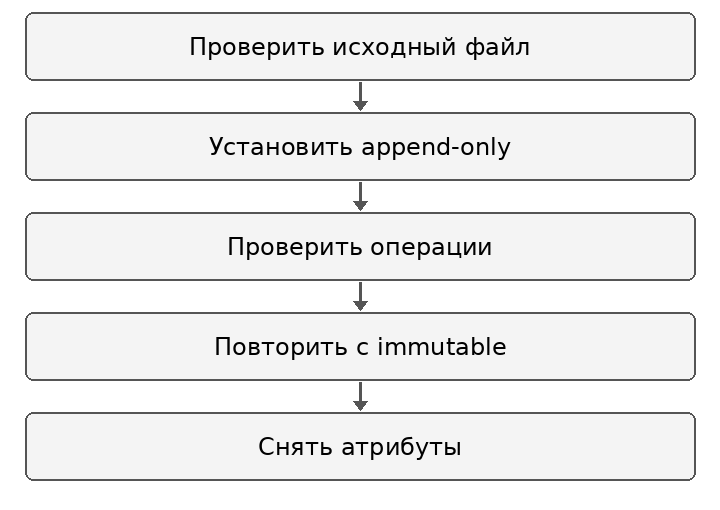
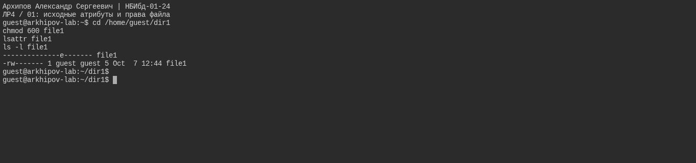
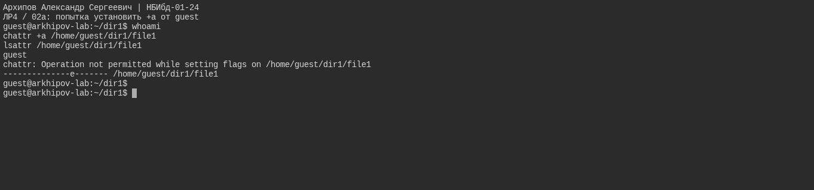
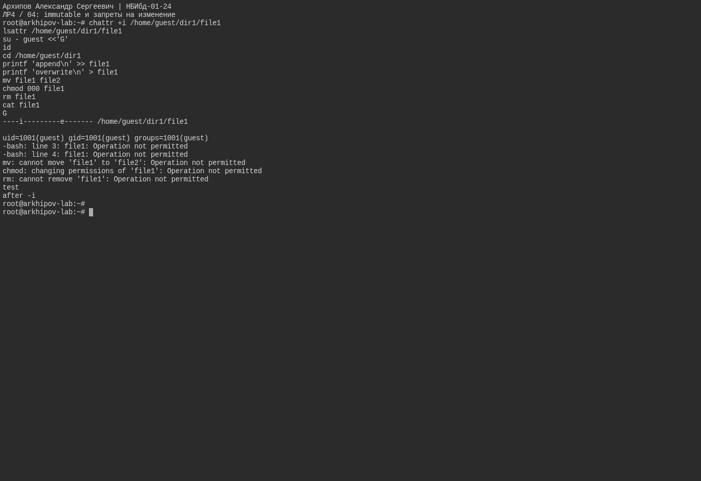
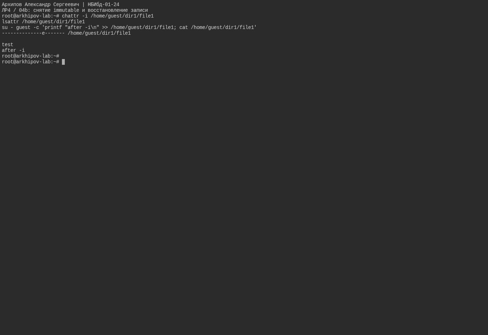

---
author:
  name: Архипов Александр Сергеевич
  email: 1132239106@rudn.ru
  affiliation:
  - name: Российский университет дружбы народов
    city: Москва
    country: Российская Федерация
title: Отчёт по лабораторной работе 4
subtitle: Дискреционное разграничение прав в Linux Расширенные атрибуты
abstract: Исследованы атрибуты append-only и immutable на файловой системе ext4. Проверены чтение, дозапись, перезапись, переименование, chmod и удаление. После снятия атрибутов подтверждено восстановление разрешённых операций.
keywords:
- информационная безопасность
- лабораторная работа
- Linux
date: '2026-10-12'
date-format: DD.MM.YYYY
lang: ru-RU
---

# Введение

Исполнитель — Архипов Александр Сергеевич, группа НБИбд-01-24. Студенческий билет 1132239106. Электронная почта: 1132239106@rudn.ru.

## Актуальность

Расширенные атрибуты могут ограничивать операции, которые разрешены обычными битами доступа. Их необходимо учитывать при защите журналов и при диагностике отказов изменения файлов.

## Цель работы

Получение практических навыков работы в консоли с расширенными атрибутами файлов.

## Задачи

1. Определить обычные права и расширенные атрибуты file1.
2. Сравнить установку append-only от guest и от root.
3. Проверить доступные операции при атрибутах a и i.
4. Снять временные атрибуты и проверить восстановление записи.

## Объект и предмет исследования

Объект исследования — файл file1 пользователя guest на ext4. Предмет исследования — влияние атрибутов a и i на операции с файлом.

## Методы исследования

Использованы lsattr, chattr и последовательные проверки чтения, записи и изменения метаданных. Управление атрибутами выполнено от root, проверки доступа — от guest.

## Схема выполнения работы

Последовательность действий показана на @fig-workflow.

{#fig-workflow width=65%}

# Теоретическая часть

Команда lsattr показывает специальные атрибуты файловой системы, а chattr изменяет их. Поддержка конкретных атрибутов зависит от файловой системы [@e2fs-chattr].

Атрибут a разрешает открывать файл для записи только в режиме добавления. Атрибут i запрещает изменение содержимого, удаление, переименование и изменение большинства метаданных. Для установки и снятия этих атрибутов требуется соответствующая привилегия, в частности CAP_LINUX_IMMUTABLE [@linux-flags].

Атрибут e означает использование extents при размещении данных ext4. Он не заменяет a или i и сам по себе не является запретом изменения файла.

# Материалы и методы

Учебная среда — Ubuntu 24.04 с файловой системой ext4. Исходный file1 принадлежит guest и имеет режим 600. Использованы lsattr, chattr, cat, перенаправления оболочки, mv, chmod и rm. В конце временные атрибуты a и i сняты. Шесть снимков фиксируют исходное состояние, отказы и восстановление операций.

# Выполнение лабораторной работы

## Исходные атрибуты и права файла

Обычный file1 принадлежит guest, режим 600. Атрибут e для ext4 не является append-only или immutable.

Результат показан на @fig-real-001.

{#fig-real-001 width=90%}

## Попытка установить  a от guest

guest не обладает правом устанавливать a; Operation not permitted ожидаем.

Результат показан на @fig-real-002.

{#fig-real-002 width=90%}

## Append-only установка root и проверки guest

После установки a администратором guest может читать и дописывать. Перезапись, mv, chmod и rm запрещены.

Результат показан на @fig-real-003.

{#fig-real-003 width=90%}

## Снятие  a и восстановление операций

После -a снова разрешены перезапись, переименование, chmod и удаление. Учебный file1 создан заново.

Результат показан на @fig-real-004.

{#fig-real-004 width=90%}

## Immutable и запреты на изменение

С i запрещены дозапись, перезапись, mv, chmod и rm. Чтение разрешено. В этой повторной проверке файл содержит test и ранее добавленную строку after -i.

Результат показан на @fig-real-005.

{#fig-real-005 width=90%}

## Снятие immutable и восстановление записи

После -i дозапись проходит; содержимое подтверждено cat.

Результат показан на @fig-real-006.

{#fig-real-006 width=90%}

# Результаты

| Операция | Атрибут a | Атрибут i |
|:---|:---:|:---:|
| Чтение | Разрешено | Разрешено |
| Дозапись | Разрешена | Запрещена |
| Перезапись | Запрещена | Запрещена |
| Переименование | Запрещено | Запрещено |
| Изменение прав chmod | Запрещено | Запрещено |
| Удаление | Запрещено | Запрещено |

: Проверенные операции с расширенными атрибутами {#tbl-results}

Попытка guest установить a завершилась Operation not permitted. После снятия a восстановились перезапись, переименование, chmod и удаление. После снятия i дозапись завершилась успешно.

# Обсуждение результатов

Отказы при обычном режиме 600 объясняются специальными атрибутами, а не отсутствием права записи владельца. Атрибут a подходит для сценария последовательного добавления данных, тогда как i блокирует и добавление, и перезапись.

Восстановление операций после снятия атрибутов подтверждает связь между состоянием a/i и наблюдаемыми отказами. Проверки относятся к ext4 и указанной учебной среде.

# Заключение

- Проверены чтение и изменение файла при append-only и immutable.
- Подтверждена необходимость привилегии для управления атрибутами a и i.
- После снятия атрибутов восстановлены обычные разрешённые операции.

# Список литературы {.unnumbered}

::: {#refs}
:::


\appendix

# Команды управления атрибутами {.appendix}

Установка и снятие a/i выполняются с соответствующей привилегией.

```bash
ls -l file1
lsattr file1
sudo chattr +a file1
sudo chattr -a file1
sudo chattr +i file1
sudo chattr -i file1
lsattr file1
```
