---
author:
  name: Архипов Александр Сергеевич
  email: 1132239106@rudn.ru
  affiliation:
  - name: Российский университет дружбы народов
    city: Москва
    country: Российская Федерация
title: Отчёт по лабораторной работе 5
subtitle: Дополнительные атрибуты Linux SetUID SetGID и Sticky
abstract: Исследованы реальные и эффективные UID/GID, действие SetUID и SetGID, а также удаление файлов в каталоге со Sticky-битом. Для проверки использованы программы на C и отдельный учебный каталог.
keywords:
- информационная безопасность
- лабораторная работа
- Linux
date: '2026-10-12'
date-format: DD.MM.YYYY
lang: ru-RU
---

# Введение

Исполнитель — Архипов Александр Сергеевич, группа НБИбд-01-24. Студенческий билет 1132239106. Электронная почта: 1132239106@rudn.ru.

## Актуальность

Специальные биты меняют контекст исполнения программы или правила удаления файлов. Ошибка в их настройке может предоставить процессу лишние привилегии либо позволить удалить чужие данные.

## Цель работы

Изучение механизмов изменения идентификаторов, применения SetUID и Sticky-битов. Получение практических навыков работы в консоли с дополнительными атрибутами. Рассмотрение работы механизма смены идентификатора процессов пользователей, а также влияние бита Sticky на запись и удаление файлов.

## Задачи

1. Собрать программы вывода реальных и эффективных идентификаторов.
2. Сравнить запуск без специальных битов, с SetUID и с SetGID.
3. Проверить чтение защищённого файла обычной и SetUID-программой.
4. Сравнить удаление чужого файла при режимах каталога 1777 и 0777.
5. Снять временные специальные биты и восстановить учебный каталог.

## Объект и предмет исследования

Объект исследования — исполняемые программы на C и учебный каталог /tmp/lab05-sticky. Предмет исследования — эффективные идентификаторы процесса и правила удаления файлов.

## Методы исследования

Использованы компиляция с предупреждениями, сравнение UID/GID в разных режимах и проверки доступа от двух пользователей. Успех и отказ определялись по выводу программ и кодам завершения.

## Схема выполнения работы

Последовательность действий показана на @fig-workflow.

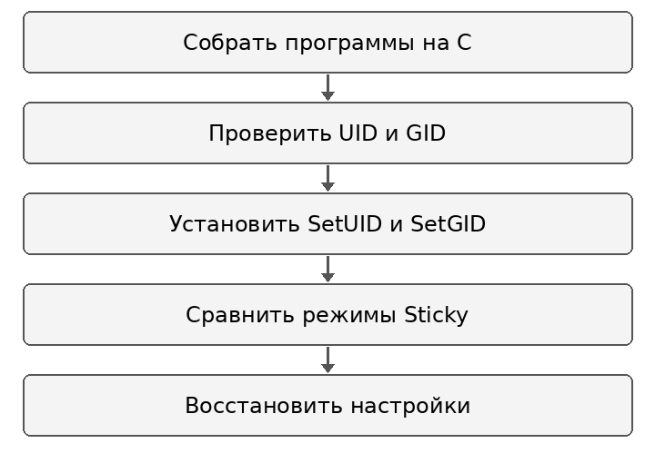{#fig-workflow width=65%}

# Теоретическая часть

Реальные UID/GID характеризуют пользователя, запустившего процесс, а эффективные идентификаторы участвуют в проверках доступа. Запуск исполняемого файла с SetUID меняет эффективный UID на идентификатор владельца файла; SetGID аналогично действует на эффективный GID. Реальные идентификаторы при execve сохраняются. Эти изменения могут быть запрещены параметром nosuid, no_new_privs или трассировкой [@linux-execve].

Sticky-бит каталога ограничивает удаление и переименование чужих файлов: запись обычно может удалить владелец файла, владелец каталога или привилегированный процесс. Он не отменяет разрешённое чтение и изменение содержимого файла [@gnu-modes].

SetUID-программе необходимы проверки аргументов и ошибок операций: её привилегии распространяются на выполняемый код. В работе программа readfile используется как учебный пример чтения с повышенными полномочиями.

# Материалы и методы

Работа выполнена в Ubuntu 24.04 с GCC 13.3 и ext4 без параметра nosuid. В системе активен AppArmor; этап переключения SELinux в Permissive не выполнялся. Использованы getuid, geteuid, getgid, getegid, chmod, chown, cat, dd и rm. Опыты со Sticky-битом выполнены в отдельном каталоге /tmp/lab05-sticky. После проверки SetUID/SetGID сняты, режим каталога 1777 восстановлен.

# Выполнение лабораторной работы

## Компилятор и фактическое окружение

GCC доступен, диск ext4 не смонтирован с nosuid. Здесь AppArmor, а не SELinux: этап setenforce 0 / Permissive из Fedora не воспроизводился.

Результат показан на @fig-real-001.

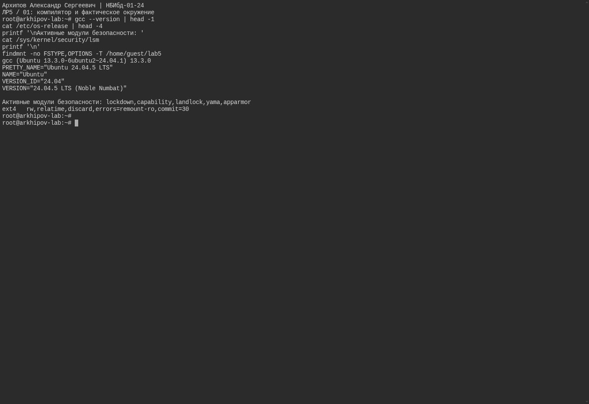{#fig-real-001 width=90%}

## Исходный код simpleid.c

Программа печатает effective UID/GID из geteuid/getegid с корректными форматами для unsigned long.

Результат показан на @fig-real-002.

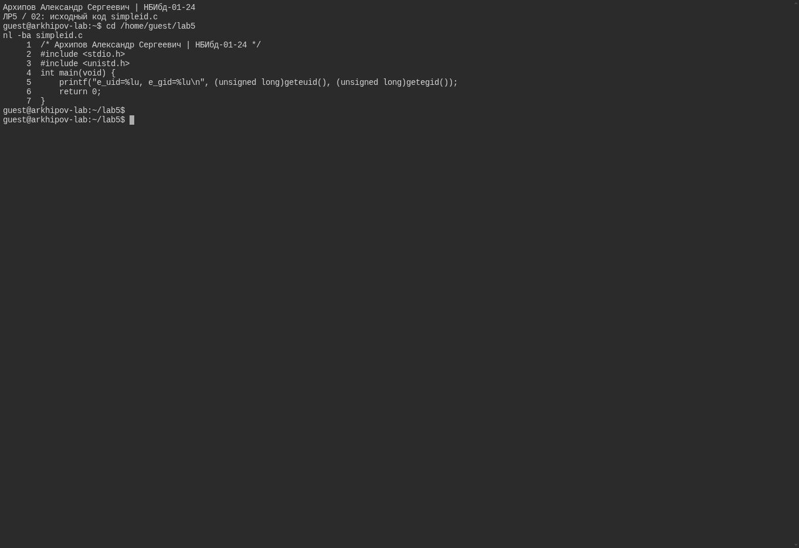{#fig-real-002 width=90%}

## Компиляция и обычные UID GID

Компиляция с -Wall -Wextra -Werror успешна. Без специальных битов e_uid/e_gid совпадают с UID/GID guest.

Результат показан на @fig-real-003.

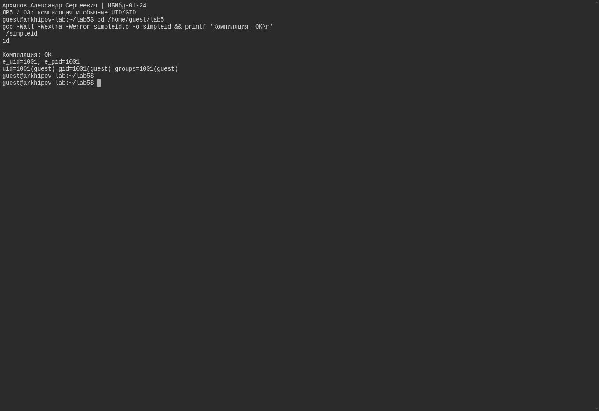{#fig-real-003 width=90%}

## Исходник с real и effective UID GID

Вторая программа отдельно печатает реальные и эффективные UID/GID. Компиляция успешна.

Результат показан на @fig-real-004.

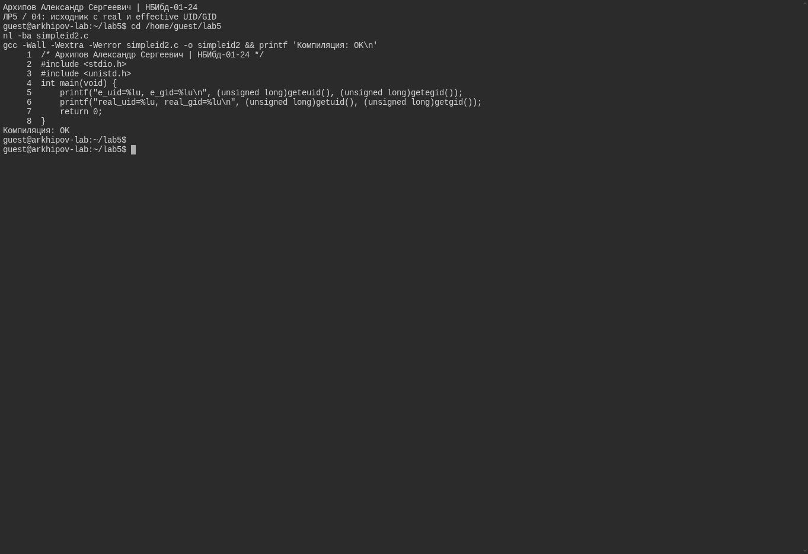{#fig-real-004 width=90%}

## SetUID владелец программы root

При 4755 и владельце root эффективный UID программы 0, реальный UID остаётся 1001.

Результат показан на @fig-real-005.

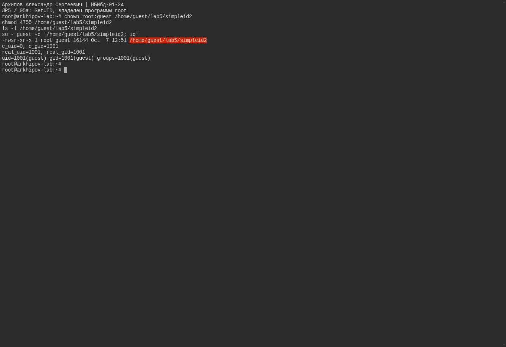{#fig-real-005 width=90%}

## SetGID группа программы root

При 2755 и группе root эффективный GID программы 0, реальный GID остаётся 1001. SetUID здесь снят.

Результат показан на @fig-real-006.

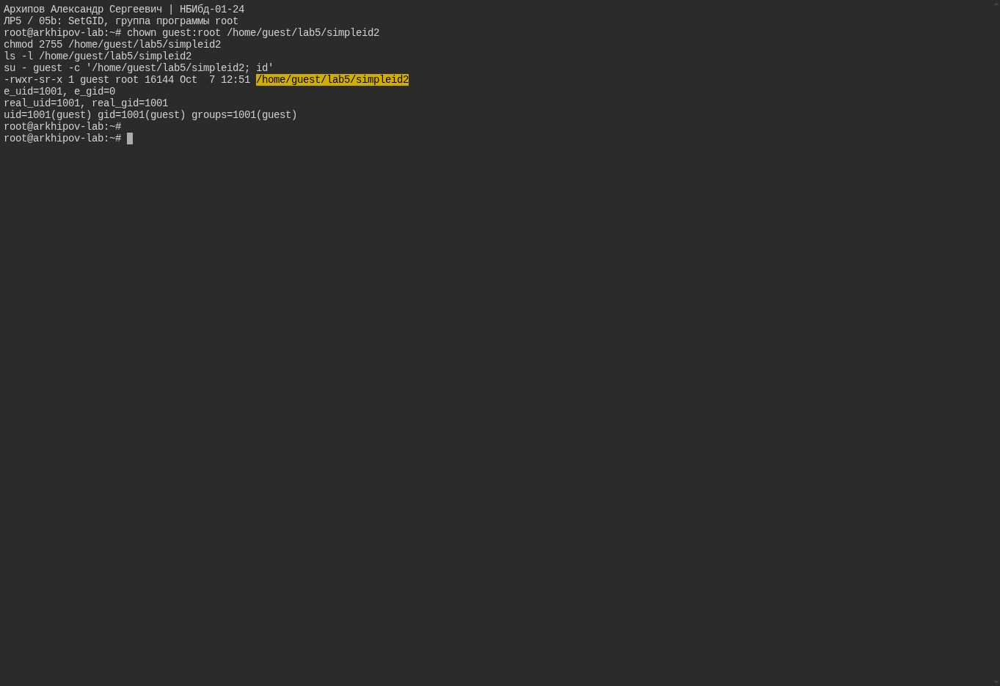{#fig-real-006 width=90%}

## Исправленный исходник readfile.c

read возвращает ssize_t; цикл читает все блоки, проверяет ошибки read/fwrite. Программа компилируется без предупреждений.

Результат показан на @fig-real-007.

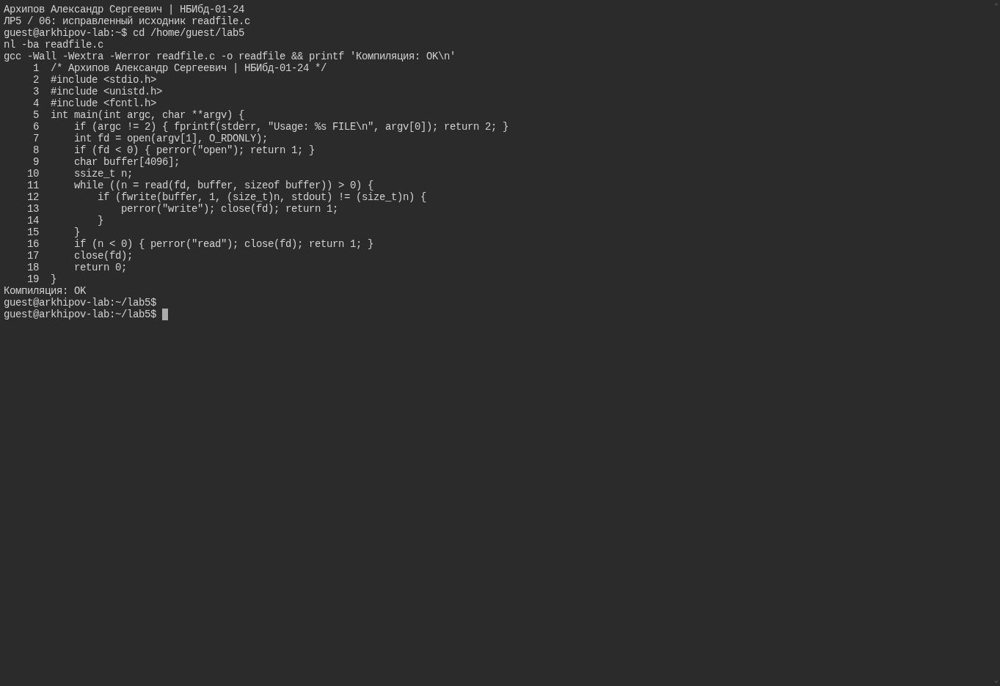{#fig-real-007 width=90%}

## Чтение root-файла без SetUID

Обычный guest не может читать root-файл с 600 ни через cat, ни через readfile без SetUID.

Результат показан на @fig-real-008.

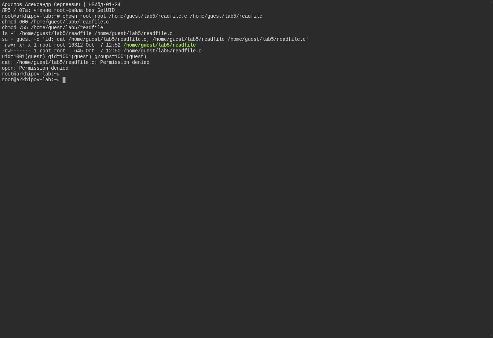{#fig-real-008 width=90%}

## Чтение защищённого файла с SetUID

SetUID-программа с владельцем root читает полный защищённый исходник. Код чтения /etc/shadow равен 0; его содержимое перенаправлено в /dev/null.

Результат показан на @fig-real-009.

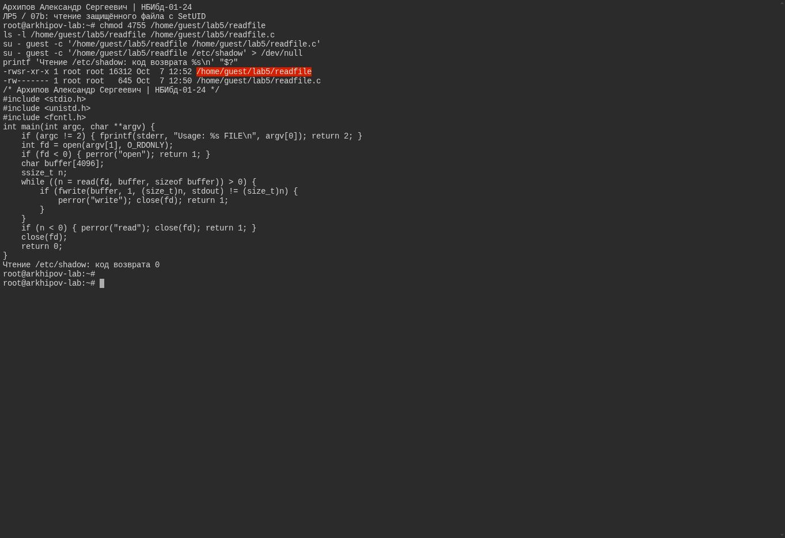{#fig-real-009 width=90%}

## Sticky-бит чтение и запись разрешены удаление чужого файла запрещено

В отдельном каталоге 1777 guest2 может читать и дописывать файл с 0666, но не удалить файл guest. dd без O_CREAT отделяет запись от fs.protected_regular.

Результат показан на @fig-real-010.

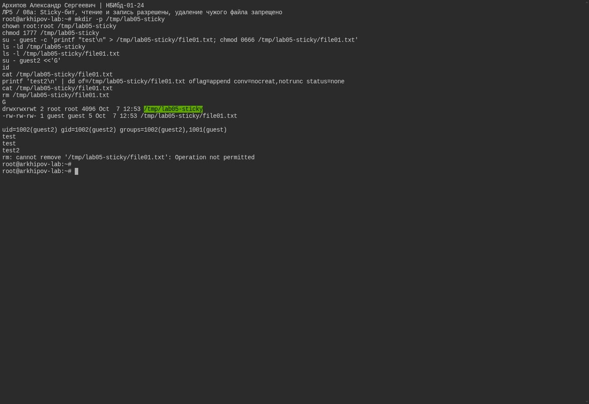{#fig-real-010 width=90%}

## Снятие Sticky-бита и восстановление 1777

При 0777 guest2 удаляет чужой файл, код 0. В конце режим 1777 восстановлен. Общие права системного /tmp не менялись.

Результат показан на @fig-real-011.

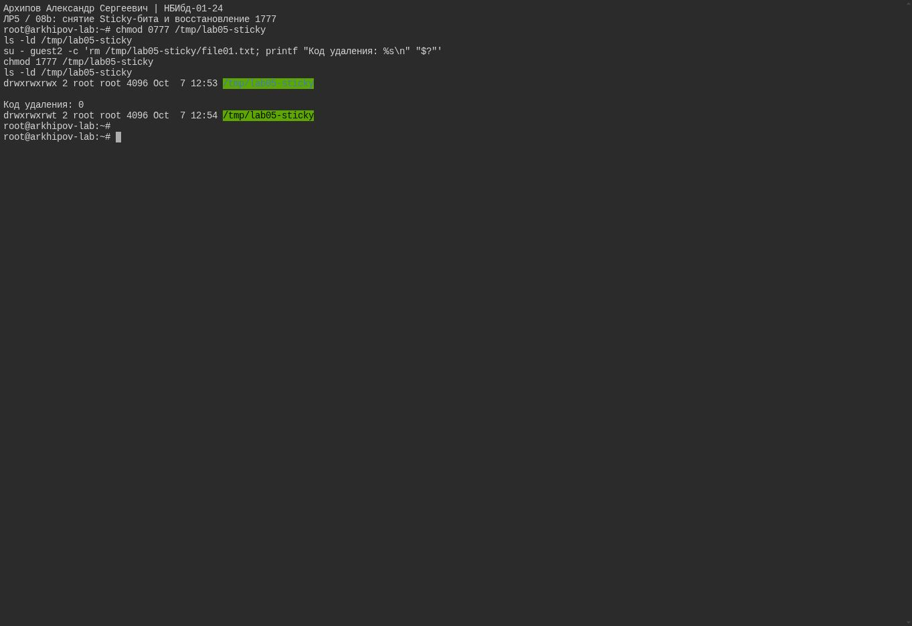{#fig-real-011 width=90%}

# Результаты

| Режим программы | Реальный UID | Эффективный UID | Реальный GID | Эффективный GID |
|:---|:---:|:---:|:---:|:---:|
| Обычный запуск guest | 1001 | 1001 | 1001 | 1001 |
| SetUID и владелец root | 1001 | 0 | 1001 | 1001 |
| SetGID и группа root | 1001 | 1001 | 1001 | 0 |

: Наблюдаемые идентификаторы процесса {#tbl-results}

Без SetUID guest не прочитал защищённый root-файл с режимом 600. SetUID-программа readfile прочитала его; проверка чтения /etc/shadow завершилась кодом 0, содержимое было перенаправлено в /dev/null.

В каталоге 1777 guest2 читал и дописывал файл с режимом 0666, но не удалял чужой файл. При режиме 0777 удаление прошло успешно. Компиляция программ с -Wall -Wextra -Werror завершилась без предупреждений.

# Обсуждение результатов

Изменение эффективного идентификатора при сохранении реального объясняет доступ SetUID-программы к файлу root. Результаты SetGID показывают самостоятельное действие группового специального бита.

Сравнение 1777 и 0777 отделяет право записи в содержимое файла от права удаления записи каталога. Использование отдельного каталога позволяет проверить это поведение без изменения общих прав системного /tmp.

# Заключение

- Подтверждено различие реальных и эффективных UID/GID.
- Проверено чтение защищённого файла программой с SetUID.
- Показано, что Sticky-бит ограничивает удаление чужих файлов, сохраняя разрешённую запись в их содержимое.
- Временные специальные биты сняты, учебный каталог восстановлен.

# Список литературы {.unnumbered}

::: {#refs}
:::


\appendix

# Листинг simpleid c {.appendix}

```c
/* Архипов Александр Сергеевич | НБИбд-01-24 */
#include <stdio.h>
#include <unistd.h>
int main(void) {
    printf("e_uid=%lu, e_gid=%lu\n", (unsigned long)geteuid(), (unsigned long)getegid());
    return 0;
}
```

# Листинг simpleid2 c {.appendix}

```c
/* Архипов Александр Сергеевич | НБИбд-01-24 */
#include <stdio.h>
#include <unistd.h>
int main(void) {
    printf("e_uid=%lu, e_gid=%lu\n", (unsigned long)geteuid(), (unsigned long)getegid());
    printf("real_uid=%lu, real_gid=%lu\n", (unsigned long)getuid(), (unsigned long)getgid());
    return 0;
}
```

# Листинг readfile c {.appendix}

```c
/* Архипов Александр Сергеевич | НБИбд-01-24 */
#include <stdio.h>
#include <unistd.h>
#include <fcntl.h>
int main(int argc, char **argv) {
    if (argc != 2) { fprintf(stderr, "Usage: %s FILE\n", argv[0]); return 2; }
    int fd = open(argv[1], O_RDONLY);
    if (fd < 0) { perror("open"); return 1; }
    char buffer[4096];
    ssize_t n;
    while ((n = read(fd, buffer, sizeof buffer)) > 0) {
        if (fwrite(buffer, 1, (size_t)n, stdout) != (size_t)n) {
            perror("write"); close(fd); return 1;
        }
    }
    if (n < 0) { perror("read"); close(fd); return 1; }
    close(fd);
    return 0;
}
```
