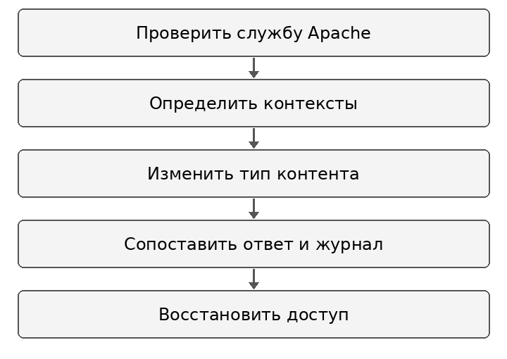
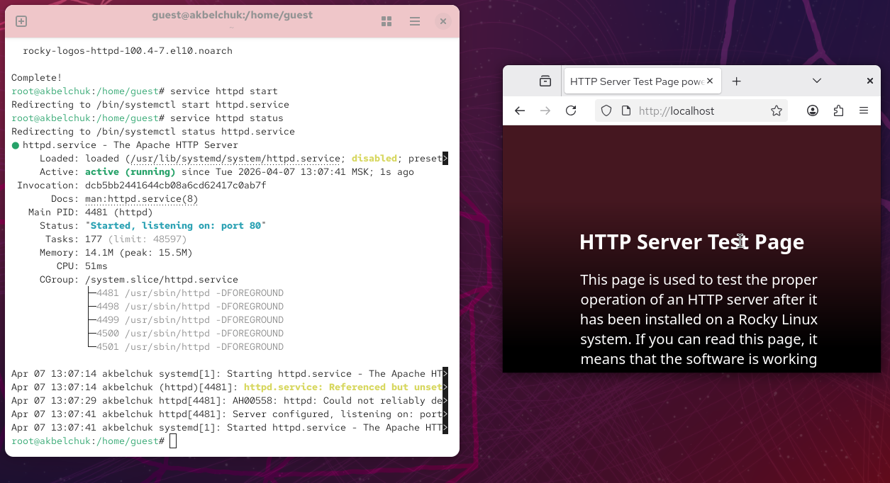
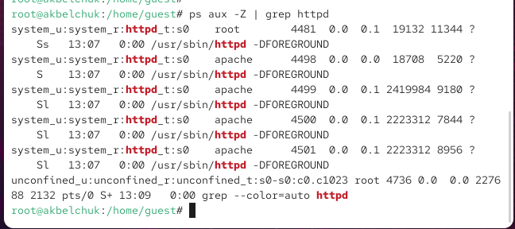
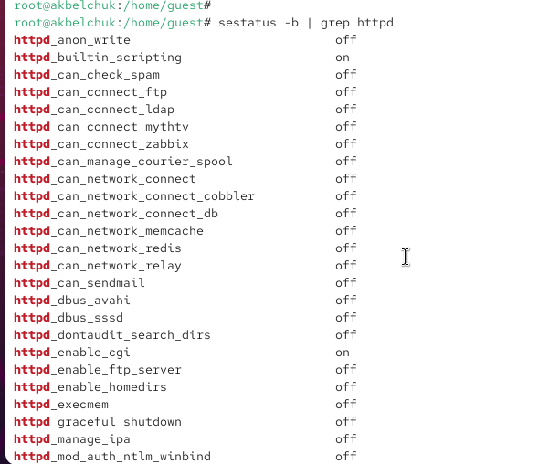
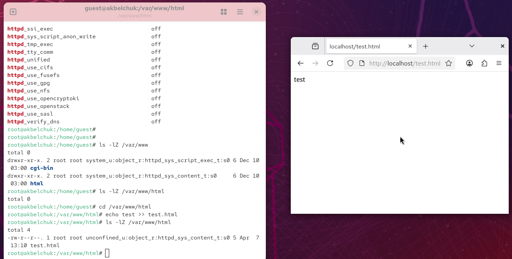
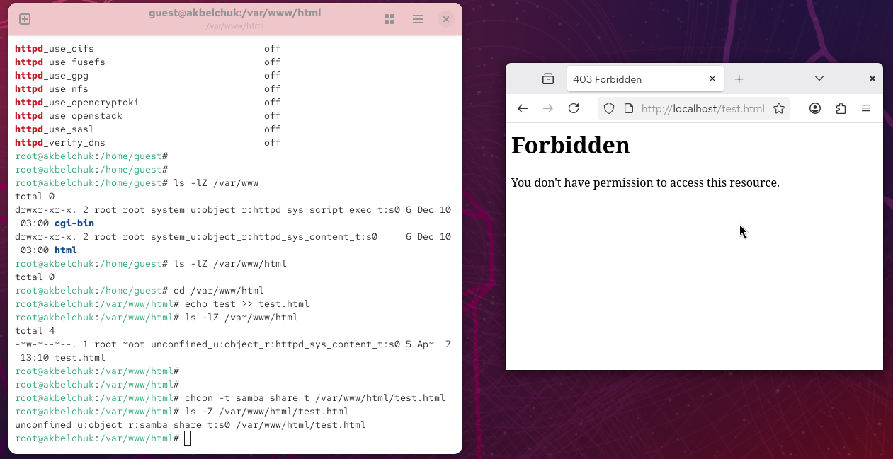
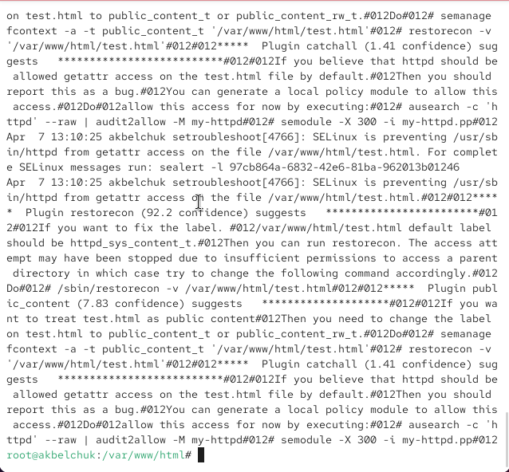
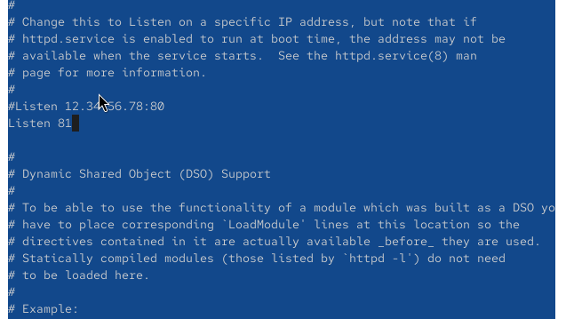

---
author:
  name: Архипов Александр Сергеевич
  email: 1132239106@rudn.ru
  affiliation:
  - name: Российский университет дружбы народов
    city: Москва
    country: Российская Федерация
title: Отчёт по лабораторной работе 6
subtitle: Знакомство с SELinux
abstract: Рассмотрена работа SELinux совместно с Apache HTTP Server. Сопоставлены контексты процесса и веб-контента, проверен отказ HTTP-доступа после изменения типа файла и доступ после восстановления контекста.
keywords:
- информационная безопасность
- лабораторная работа
- Linux
date: '2026-10-12'
date-format: DD.MM.YYYY
lang: ru-RU
---

# Введение

Исполнитель — Архипов Александр Сергеевич, группа НБИбд-01-24. Студенческий билет 1132239106. Электронная почта: 1132239106@rudn.ru.

## Актуальность

Обычные права чтения файла не гарантируют доступ службы к нему: SELinux дополнительно проверяет типы процесса, объекта и сетевого порта. Эти проверки важны при настройке и диагностике веб-сервера.

## Цель работы

Развить навыки администрирования ОС Linux. Получить первое практическое знакомство с технологией SELinux. Проверить работу SELinux на практике совместно с веб-сервером Apache.

## Задачи

1. Проверить службу httpd и её контекст безопасности.
2. Изучить переключатели SELinux, относящиеся к Apache.
3. Создать test.html и определить тип веб-контента.
4. Изменить тип файла на samba_share_t и проанализировать отказ.
5. Проверить настройку Listen 81 и восстановление контекста файла.

## Объект и предмет исследования

Объект исследования — служба Apache HTTP Server, файл /var/www/html/test.html и TCP-порт веб-сервера. Предмет исследования — влияние типов SELinux на чтение контента и прослушивание порта.

## Методы исследования

Использованы просмотр контекстов через ps и ls -Z, изменение типа файла командой chcon, HTTP-запросы в браузере и анализ сообщений setroubleshoot. Настройки порта сопоставлены с выводом semanage port.

## Схема выполнения работы

Последовательность действий показана на @fig-workflow.

{#fig-workflow width=65%}

# Теоретическая часть

SELinux реализует обязательные проверки доступа поверх обычных разрешений Linux. Контекст включает пользователя SELinux, роль, тип и уровень. Для Apache используется тип процесса httpd_t, а для статического веб-контента — httpd_sys_content_t [@redhat-selinux].

Изменение типа контента может привести к отказу чтения даже при доступных обычных правах. Команда chcon меняет текущую метку; restorecon восстанавливает метку по правилам файловых контекстов. Постоянное правило для нестандартного пути задают через semanage fcontext [@redhat-labels].

Разрешённые для httpd сетевые порты связаны с типом http_port_t. Текущий список проверяют командой semanage port -l. Необходимость добавления порта зависит от уже действующей политики [@redhat-ports].

# Материалы и методы

Учебная Linux-система с установленными httpd и SELinux. На странице тестового сервера указан Rocky Linux. Использованы service, ps aux -Z, sestatus -b, ls -lZ, chcon, semanage и браузер. Работа выполнялась с конфигурацией /etc/httpd/conf/httpd.conf и каталогом /var/www/html. Восемь снимков показывают состояние службы, контексты, HTTP-ответы, журнал и настройку порта.

# Выполнение лабораторной работы

## Запуск веб сервера

Команда service httpd status показывает active running. В браузере открыта тестовая страница Apache. Состояние службы и HTTP-страница представлены на @fig-001.

{#fig-001 width=90%}

## Контекст процессов Apache

Вывод ps aux -Z показывает контекст system_u:system_r:httpd_t:s0 для процессов веб-сервера. Тип процесса — httpd_t. См. @fig-002.

{#fig-002 width=90%}

## Переключатели SELinux для Apache

Команда sestatus -b | grep httpd выводит переключатели политики. На снимке большинство значений off; httpd_builtin_scripting и httpd_enable_cgi имеют значение on. См. @fig-003.

{#fig-003 width=90%}

## Создание и чтение веб контента

В /var/www/html создан test.html с содержимым test. Вывод ls -lZ показывает тип httpd_sys_content_t. Браузер отображает файл по HTTP. См. @fig-004.

{#fig-004 width=90%}

## Изменение типа и отказ доступа

После chcon -t samba_share_t /var/www/html/test.html браузер возвращает 403 Forbidden. Вывод ls -Z подтверждает тип samba_share_t. См. @fig-005.

{#fig-005 width=90%}

## Анализ журнала

В журнале присутствуют сообщения setroubleshoot о запрете обращения процесса httpd к test.html. Среди рекомендаций указано восстановление метки через restorecon. См. @fig-006.

{#fig-006 width=90%}

## Настройка порта Apache

В файле /etc/httpd/conf/httpd.conf директива Listen имеет значение 81. Этот фрагмент конфигурации показан на @fig-007.

{#fig-007 width=90%}

## Проверка политики порта и восстановление контекста

После перезапуска выполнены semanage port -a -t http_port_t -p tcp 81 и просмотр списка портов. Сообщение Port tcp/81 already defined, modifying instead указывает на существующее определение. Порт 81 присутствует в http_port_t. После chcon -t httpd_sys_content_t содержимое test.html снова отображается в браузере. См. @fig-008.

{#fig-008 width=90%}

# Результаты

| Проверка | Наблюдение |
|:---|:---|
| Служба httpd | Состояние active running и тестовая HTTP-страница |
| Контекст процессов Apache | Тип httpd_t |
| Файл с типом httpd_sys_content_t | Содержимое test доступно по HTTP |
| Файл с типом samba_share_t | Ответ 403 Forbidden |
| Журнал setroubleshoot | Сообщения о запрете доступа httpd к test.html |
| Настройка Listen 81 | Порт 81 присутствует в списке http_port_t |
| Восстановление типа файла | Содержимое test снова доступно |

: Результаты проверки SELinux и Apache {#tbl-results}

Команда добавления порта 81 сообщает Port tcp/81 already defined, modifying instead. Это наблюдение показывает, что порт уже определён; отсутствие сбоя не следует считать признаком отключённого SELinux.

# Обсуждение результатов

Отказ после назначения samba_share_t связан с несовместимым для веб-контента типом объекта. Сообщения журнала связывают отказ с процессом httpd и файлом test.html. Восстановление httpd_sys_content_t возвращает доступ к содержимому.

Проверка порта требует учитывать фактический список политики. В данном примере 81 уже разрешён как http_port_t, поэтому изменение Listen само по себе не воспроизводит отказ привязки к запрещённому порту. Для диагностики необходимо сопоставлять конфигурацию Apache, метку порта и журнал.

# Заключение

- Определены типы процесса Apache и статического веб-контента.
- Показан отказ HTTP-доступа после изменения контекста файла и восстановление доступа при возврате подходящего типа.
- Проверено, что разрешение нестандартного порта зависит от текущей политики SELinux.

# Список литературы {.unnumbered}

::: {#refs}
:::


\appendix

# Команды проверки SELinux {.appendix}

Основные команды, рассмотренные в работе:

```bash
service httpd status
ps aux -Z | grep httpd
sestatus -b | grep httpd
ls -lZ /var/www/html/test.html
chcon -t samba_share_t /var/www/html/test.html
semanage port -l | grep http_port_t
chcon -t httpd_sys_content_t /var/www/html/test.html
```

При завершении опыта возвращают исходную директиву Listen. Удаляют только созданную для опыта локальную привязку порта, если она была добавлена; существующее правило политики сохраняют. Учебный test.html удаляют после проверки.
