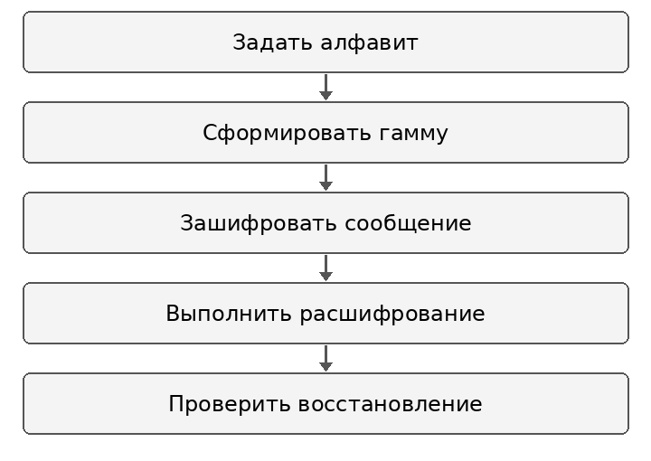
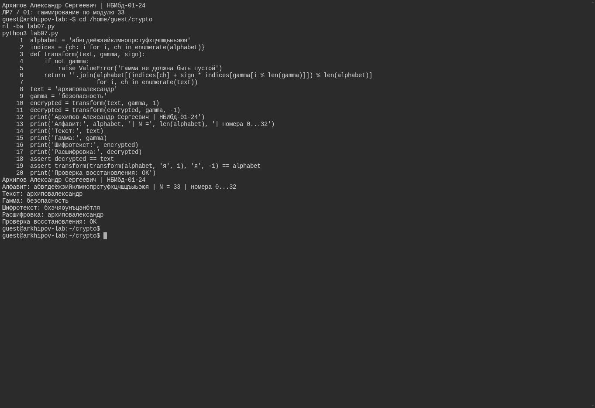

---
author:
  name: Архипов Александр Сергеевич
  email: 1132239106@rudn.ru
  affiliation:
  - name: Российский университет дружбы народов
    city: Москва
    country: Российская Федерация
title: Отчёт по лабораторной работе 7
subtitle: Шифр гаммирования по модулю 33
abstract: Реализовано шифрование и расшифрование сложением и вычитанием по модулю 33. Использован русский алфавит с буквой ё и проверено точное восстановление сообщения и полного алфавита.
keywords:
- информационная безопасность
- лабораторная работа
- гаммирование
date: '2026-10-12'
date-format: DD.MM.YYYY
lang: ru-RU
---

# Введение

Исполнитель — Архипов Александр Сергеевич, группа НБИбд-01-24. Студенческий билет 1132239106. Электронная почта: 1132239106@rudn.ru.

## Актуальность

Гаммирование позволяет изучить обратимость шифрования и роль единого соглашения о кодировании символов. Ошибка в порядке алфавита или модуле нарушает восстановление исходного текста.

## Цель работы

Изучение алгоритма шифрования гаммированием.

## Задачи

1. Задать единый алфавит из 33 букв и таблицу индексов 0–32.
2. Реализовать сложение и вычитание индексов по модулю 33.
3. Зашифровать текст архиповалександр с гаммой безопасность.
4. Проверить восстановление сообщения и всех символов алфавита.

## Объект и предмет исследования

Объект исследования — строки русского алфавита и повторяемая гамма. Предмет исследования — обратимость преобразования индексов по модулю 33.

## Методы исследования

Использованы программная реализация на Python, прямое и обратное преобразования и автоматические проверки assert для сообщения и алфавита.

## Схема выполнения работы

Последовательность действий показана на @fig-workflow.

{#fig-workflow width=65%}

# Теоретическая часть

Каждой букве сопоставлен индекс p_i от 0 до 32. Для гаммы g_i шифрование и расшифрование задаются формулами:

$$c_i = (p_i + g_i) \bmod 33,$$

$$p_i = (c_i - g_i) \bmod 33.$$

Обратимость следует из того, что прибавление и последующее вычитание одного индекса дают исходный остаток. В Python операция % реализует вычисление остатка, а индексация строк возвращает выбранный символ [@python-expressions].

Если гамма короче текста, в данной учебной программе она повторяется по индексам i mod L. Такая демонстрация не является одноразовым блокнотом: повторяемая известная гамма не обеспечивает его условий секретности. Преобразование по модулю 33 следует отличать от побитового XOR байтов.

# Материалы и методы

Программа lab07.py запущена в консольной среде Ubuntu. Алфавит содержит 33 уникальные русские буквы, включая ё; номера начинаются с 0. Исходный текст — архиповалександр, гамма — безопасность. Использована функция transform с параметром знака и циклическим обращением к гамме.

# Выполнение лабораторной работы

## Гаммирование по модулю 33

Взяты 33 уникальные русские буквы с ё, номера 0...32. Сложение/вычитание выполняется по модулю 33. Исходный текст восстанавливается точно; XOR и таблица из 44 знаков с этой программой не смешиваются.

Результат показан на @fig-real-001.

{#fig-real-001 width=90%}

# Результаты

| Параметр | Значение |
|:---|:---|
| Размер алфавита | 33 буквы |
| Диапазон индексов | 0–32 |
| Исходное сообщение | архиповалександр |
| Гамма | безопасность |
| Проверка сообщения | decrypted == text |
| Проверка полного алфавита | Обратное преобразование восстанавливает все 33 буквы |

: Проверенные свойства программы {#tbl-results}

На снимке показаны шифротекст, восстановленное сообщение и строка Проверка восстановления OK. Полный листинг приведён в приложении.

# Обсуждение результатов

Точное восстановление подтверждает согласованность алфавита, нумерации и арифметики. Отдельная проверка всех букв охватывает также ё и переход через границу диапазона индексов.

Проверки доказывают обратимость конкретной реализации, но не её криптографическую стойкость. Для практического шифрования потребовались бы отдельные требования к формированию гаммы и управлению ключами.

# Заключение

- Реализованы прямое и обратное преобразования по модулю 33.
- Подтверждено точное восстановление сообщения и полного алфавита.
- Разграничены учебная повторяемая гамма и условия одноразового использования ключа.

# Список литературы {.unnumbered}

::: {#refs}
:::


\appendix

# Листинг программы {.appendix}

```python
alphabet = 'абвгдеёжзийклмнопрстуфхцчшщъыьэюя'
indices = {ch: i for i, ch in enumerate(alphabet)}
def transform(text, gamma, sign):
    if not gamma:
        raise ValueError('Гамма не должна быть пустой')
    return ''.join(alphabet[(indices[ch] + sign * indices[gamma[i % len(gamma)]]) % len(alphabet)]
                   for i, ch in enumerate(text))
text = 'архиповалександр'
gamma = 'безопасность'
encrypted = transform(text, gamma, 1)
decrypted = transform(encrypted, gamma, -1)
print('Архипов Александр Сергеевич | НБИбд-01-24')
print('Алфавит:', alphabet, '| N =', len(alphabet), '| номера 0...32')
print('Текст:', text)
print('Гамма:', gamma)
print('Шифротекст:', encrypted)
print('Расшифровка:', decrypted)
assert decrypted == text
assert transform(transform(alphabet, 'я', 1), 'я', -1) == alphabet
print('Проверка восстановления: OK')
```
