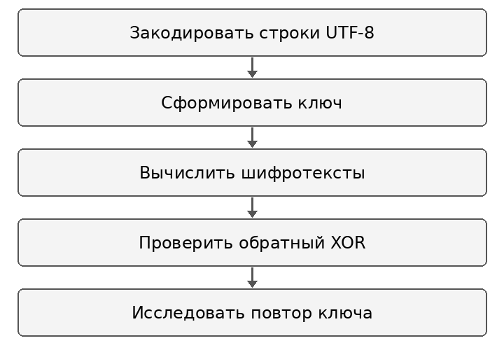

---
author:
  name: Архипов Александр Сергеевич
  email: 1132239106@rudn.ru
  affiliation:
  - name: Российский университет дружбы народов
    city: Москва
    country: Российская Федерация
title: Отчёт по лабораторной работе 8
subtitle: XOR гаммирование и повторное использование ключа
abstract: Реализовано XOR-шифрование байтов UTF-8 с ключом из secrets.token_bytes. Проверено восстановление двух сообщений и показана учебная атака при повторном использовании одного ключа.
keywords:
- информационная безопасность
- лабораторная работа
- гаммирование
date: '2026-10-12'
date-format: DD.MM.YYYY
lang: ru-RU
---

# Введение

Исполнитель — Архипов Александр Сергеевич, группа НБИбд-01-24. Студенческий билет 1132239106. Электронная почта: 1132239106@rudn.ru.

## Актуальность

Повторное использование гаммы связывает шифротексты разных сообщений. Учебный пример позволяет проследить, как известный открытый текст раскрывает другое сообщение при совпадающем ключе.

## Цель работы

Освоить на практике применение режима однократного гаммирования на примере кодирования различных исходных текстов одним ключом.

## Задачи

1. Преобразовать две строки в байты UTF-8 и проверить равенство длин.
2. Сформировать случайный ключ длиной 25 байт.
3. Реализовать XOR-шифрование и расшифрование.
4. Восстановить второе сообщение по C1, C2 и известному P1 при повторении ключа.
5. Проверить восстановление ключа и исходных сообщений.

## Объект и предмет исследования

Объект исследования — байтовые представления строк КодоваяФраза1 и Безопасность2. Предмет исследования — обратимость XOR и утечка при повторении ключа.

## Методы исследования

Использованы побайтовое XOR-преобразование, генерация ключа через secrets.token_bytes и автоматические проверки assert для расшифрования и учебной атаки.

## Схема выполнения работы

Последовательность действий показана на @fig-workflow.

{#fig-workflow width=65%}

# Теоретическая часть

XOR применяется к каждой паре байтов одинаковой длины. Основные свойства операции — a XOR a = 0 и a XOR 0 = a — обеспечивают обратимость:

$$C = P \oplus K, \qquad P = C \oplus K.$$

При повторении ключа выполняется:

$$C_1 \oplus C_2 = P_1 \oplus P_2,$$

$$P_2 = C_1 \oplus C_2 \oplus P_1, \qquad K = C_1 \oplus P_1.$$

Эти равенства позволяют восстановить позиции второго сообщения, для которых известны соответствующие байты первого. Они не означают автоматического восстановления двух произвольных неизвестных сообщений.

Функция secrets.token_bytes возвращает случайную последовательность заданной длины, используя источник случайности операционной системы [@python-secrets]. Случайность ключа не устраняет уязвимость его повторного использования.

# Материалы и методы

Программа lab08.py запущена в консольной среде Ubuntu. Каждая строка занимает 25 байт UTF-8. Ключ генерируется заново при запуске; его повторение для двух сообщений используется внутри учебного примера. Программа имеет обычный режим и режим attack. Шифротексты разных запусков могут отличаться.

# Выполнение лабораторной работы

## Атака на повторно использованный XOR-ключ

При одном ключе C1 XOR C2 XOR P1 восстанавливает P2; C1 XOR P1 восстанавливает ключ. Обе проверки assert прошли. Шифротексты меняются при новом запуске.

Результат показан на @fig-real-001.

{#fig-real-001 width=90%}

## Точное XOR-шифрование и расшифровка UTF-8

XOR применяется к байтам UTF-8; обе фразы имеют длину 25 байт. Обратное преобразование восстанавливает каждую фразу точно, без замены букв. Здесь новый случайный ключ, отличный от снимка атаки.

Результат показан на @fig-real-002.

{#fig-real-002 width=90%}

# Результаты

| Проверка | Результат |
|:---|:---|
| Размер P1 и P2 | По 25 байт UTF-8 |
| Обычный режим | Оба сообщения восстановлены точно |
| Ключ из C1 и известного P1 | Совпадает с исходным ключом |
| P2 из C1 XOR C2 XOR P1 | Получено Безопасность2 |
| Автоматические проверки | Все условия assert выполнены |

: Результаты XOR-преобразования и учебной атаки {#tbl-results}

Снимки обычного режима и атаки относятся к разным запускам и используют разные случайные ключи. Сравниваются свойства восстановления, а не совпадение шифротекстов между снимками.

# Обсуждение результатов

Точное восстановление строк подтверждает корректную работу с байтами UTF-8: ключ соответствует длине закодированного сообщения, а не количеству видимых символов.

Учебная атака показывает, что повторение ключа сокращает задачу до XOR известных величин. Условия одноразового гаммирования требуют не использовать одну гамму повторно; один только выбор криптографически подходящего генератора не обеспечивает это условие.

# Заключение

- Реализовано обратимое XOR-преобразование сообщений UTF-8.
- Подтверждено восстановление второго сообщения и ключа при наличии известного первого сообщения.
- Показана необходимость исключать повторное использование одной гаммы.

# Список литературы {.unnumbered}

::: {#refs}
:::


\appendix

# Листинг программы {.appendix}

```python
import secrets
import sys
def xor(a, b):
    if len(a) != len(b):
        raise ValueError('Длины байтовых строк должны совпадать')
    return bytes(x ^ y for x, y in zip(a, b))
p1 = 'КодоваяФраза1'.encode('utf-8')
p2 = 'Безопасность2'.encode('utf-8')
assert len(p1) == len(p2)
key = secrets.token_bytes(len(p1))
c1, c2 = xor(p1, key), xor(p2, key)
print('Архипов Александр Сергеевич | НБИбд-01-24')
print('P1:', p1.decode())
print('P2:', p2.decode())
print('Длина в байтах:', len(p1))
print('C1 (hex):', c1.hex())
print('C2 (hex):', c2.hex())
if len(sys.argv) > 1 and sys.argv[1] == 'attack':
    recovered_key = xor(c1, p1)
    recovered_p2 = xor(xor(c1, c2), p1)
    assert recovered_key == key
    assert recovered_p2 == p2
    print('Восстановленный P2 из C1, C2 и известного P1:', recovered_p2.decode())
    print('Восстановление ключа по известному P1: OK')
else:
    d1, d2 = xor(c1, key), xor(c2, key)
    assert d1 == p1 and d2 == p2
    print('Расшифрованный P1:', d1.decode())
    print('Расшифрованный P2:', d2.decode())
    print('Точное восстановление обоих сообщений: OK')
```
